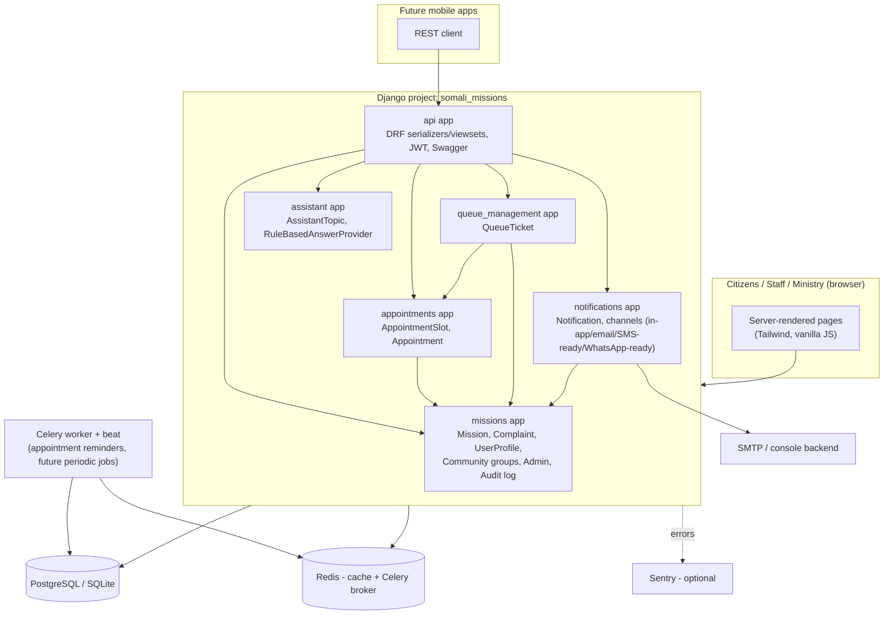

# Architecture

## Overview

A single Django project (`somali_missions`) composed of six apps, each owning its own models/views/templates/migrations. There is no microservice split - this is a monolith by design, appropriate for the current scale (a few thousand citizens, a few dozen missions), with clear internal boundaries so it could be split later if it ever needed to.

## App responsibilities

| App | Owns | Depends on |
|---|---|---|
| `missions` | Mission directory, Complaint workflow, UserProfile/roles, community groups, admin, audit log, KPI dashboard, permissions helpers | — (foundation app) |
| `appointments` | Slot booking, no-double-booking, QR confirmation, staff approve/reject/reschedule | `missions` (Mission, MissionService, permissions) |
| `queue_management` | Walk-in ticket numbers, call-next/skip/recall, display screen | `missions`, `appointments` (optional link) |
| `assistant` | Rule-based Q&A, pluggable `AnswerProvider` for a future AI backend | — |
| `notifications` | In-app + email notifications, channel abstraction, emergency broadcast | `missions` (UserProfile for broadcast targeting) |
| `api` | DRF serializers/viewsets wrapping the above, JWT auth, Swagger | all of the above |

## Shared permission model

Every mission-scoped view (web or API) goes through three functions in `missions/utils/permissions.py`:

- `user_is_ministry_admin(user)` — superuser, `MinistryAdmin` Django group, or `UserProfile.role` of `MINISTRY_ADMIN`/`MINISTRY_REVIEWER`
- `user_can_manage_mission(user, mission)` — ministry admin, or staff of that specific mission (via `Mission.staff_users` group membership, or `UserProfile.mission` + role)
- `missions_for_user(user)` — all missions for ministry admins, else just the missions the user is scoped to

`UserProfile.role`/`mission` is the **single source of truth**. Django Groups (`MinistryAdmin`/`MissionStaff`) and `Mission.staff_users` are an automatic *projection* of the role, kept in sync by `sync_user_permissions()` (in `missions/utils/permissions.py`, wired to a `post_save` signal on `UserProfile` in `missions/signals.py`): set someone's role and their group membership + mission assignment follow automatically, and demoting them removes the stale memberships. This means the two representations can't drift. The three helper functions still read both (belt-and-braces, and Django admin's own permission system keys off Groups), but the signal guarantees they agree. `python manage.py sync_permissions` reconciles all existing users on demand (e.g. after someone edits Groups directly in the admin). This is why both the seed command (Groups + role) and the invitation flow (role only) produce a fully consistent account.

## Request flow example: booking an appointment

1. Citizen hits `/appointments/book/`, picks mission + service, sees available `AppointmentSlot`s.
2. POST is handled inside `transaction.atomic()` with `AppointmentSlot.objects.select_for_update()` — this is what prevents two simultaneous requests from both booking the last spot in a slot; the second one is auto-waitlisted instead.
3. A QR code (`qrcode` library) and confirmation email are generated immediately; the citizen is redirected to a confirmation page.
4. Embassy staff (scoped to their own mission only) approve/reject the appointment from `/appointments/staff/`.
5. `notify()` (from `notifications/channels.py`) creates an in-app notification and emails the citizen if they have a registered account.
6. The same booking flow is available at `/api/v1/appointments/` for a future mobile client, using the identical `select_for_update()` logic.

## Background jobs

Celery is configured (`somali_missions/celery.py`) with one task today: `appointments.tasks.send_appointment_reminders_task`, wrapping the `send_appointment_reminders` management command. It's schedulable via Celery Beat's admin UI (`django_celery_beat`) once a periodic task is added there, or run directly via host cron - see [DEPLOYMENT.md](DEPLOYMENT.md).
