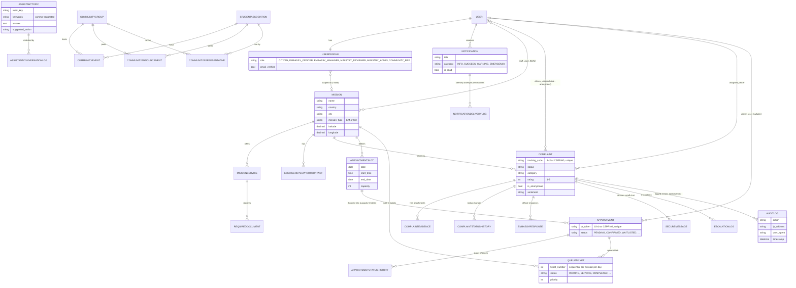

# Entity-Relationship Diagram

Focused on the core entities and their relationships. Field lists are trimmed to what matters for understanding the data model - see `missions/models.py`, `appointments/models.py`, `queue_management/models.py`, `assistant/models.py`, `notifications/models.py` for full field definitions.

## Notes on design choices

- **Tracking codes and QR tokens** are generated with `secrets.choice` (CSPRNG), not sequential IDs - unguessable, so knowing one code doesn't help you enumerate others. See `Complaint.tracking_code` / `Appointment.qr_token`.
- **Anonymous complaints**: `Complaint.citizen_user` is nullable; when `is_anonymous=True`, `full_name`/`email`/`phone` are blanked on save (see `Complaint.save()`) rather than just hidden in the UI - the PII genuinely isn't retained.
- **Dual staff-scoping paths**: a user can be scoped to a mission either via `Mission.staff_users` (M2M, set by Django Group-based provisioning) or via `UserProfile.mission` + `UserProfile.role` (set by the invitation flow). Both are checked everywhere via `missions/utils/permissions.py` - see [ARCHITECTURE.md](ARCHITECTURE.md).
- **AuditLog.complaint is nullable** - it started as complaint-only, then was extended (migration 0008) to also log account-level events (login, role changes, exports) with no associated complaint.
